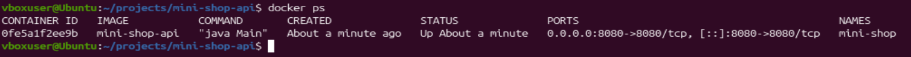
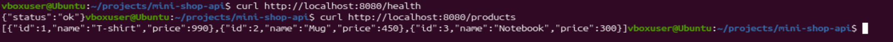
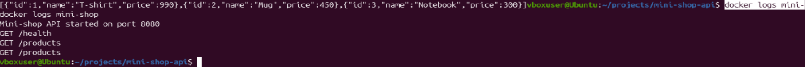

# Mini Shop API

Простое API для проекта «мини-магазин» на Java, упакованное в Docker-контейнер.

## Endpoints

- `GET /health` — проверка, что сервис работает
- `GET /products` — список товаров магазина

## Сборка образа

```bash
docker build -t mini-shop-api .
```

## Запуск контейнера

```bash
docker run -d -p 8080:8080 --name mini-shop mini-shop-api
```

## Проверка

```bash
docker ps
curl http://localhost:8080/health
curl http://localhost:8080/products
docker logs mini-shop
```

## Результаты проверки

### docker ps


### Запрос к API


### docker logs

